<div align="center">

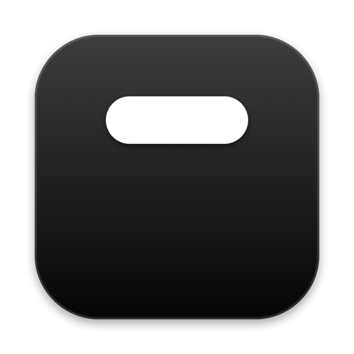

# DynamicBar

**Your notch, alive.**
A Liquid Glass island for the Mac notch — now playing, volume & brightness, the charger, a tray for anything you drop on it, and add-ons you write in JavaScript.

[](#requirements)
[](LICENSE.md)
[](#add-ons-dynamicbarkit)

[**Website**](https://kag1o.github.io/DynamicBar/) · [**Download**](https://github.com/KAG1O/DynamicBar/releases/latest) · [**Developer docs**](https://kag1o.github.io/DynamicBar/developer.html) · [**Add-on playground**](https://kag1o.github.io/DynamicBar/developer.html#playground)

<br>

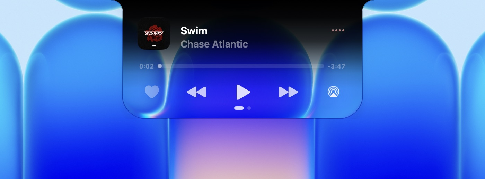

</div>

---

## Features

<table>
<tr>
<td width="50%"></td>
<td width="50%">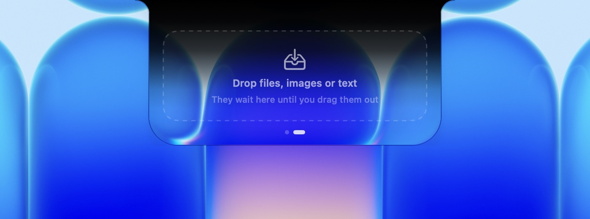</td>
</tr>
<tr>
<td><b>Now Playing</b><br>Artwork, scrubbing, AirPlay and favourites from anything that plays: Music, Spotify, a video in the browser, a podcast. Closed, the cover sits left of the notch and a tinted equalizer moves on the right.</td>
<td><b>Tray</b><br>Drop files, images, links or text on the island. They wait there until you drag them out. Swipe between pages with two fingers.</td>
</tr>
<tr>
<td>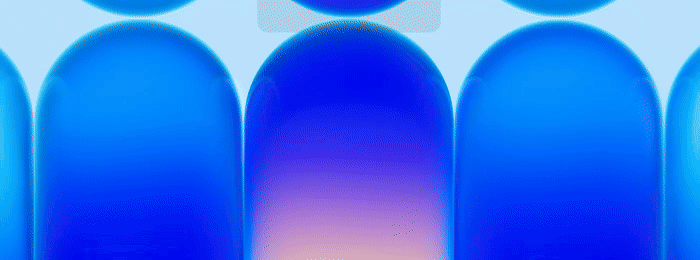</td>
<td>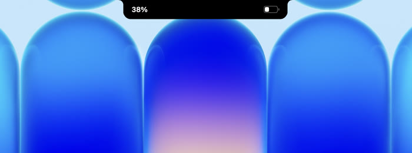</td>
</tr>
<tr>
<td><b>Volume & Brightness</b><br>Press a key and the island stretches to show the level. Or show it as a pill on the left or right edge of the screen, and drag it.</td>
<td><b>Charger</b><br>The battery level shows beside the notch when you plug in or unplug.</td>
</tr>
<tr>
<td>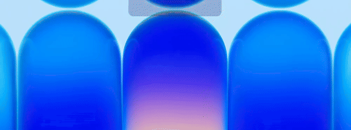</td>
<td>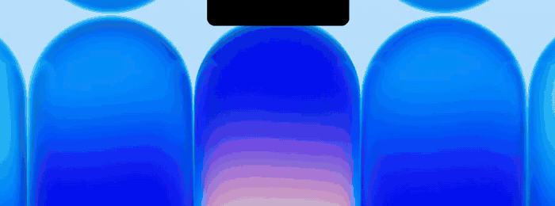</td>
</tr>
<tr>
<td><b>Lock screen</b><br>A padlock closes and opens as the screen locks and unlocks.</td>
<td><b>Made of glass</b><br>Clear glass that bends the wallpaper, or solid black like the notch itself. Set the tint anywhere in between.</td>
</tr>
</table>

- **Feels physical** — the island swells under the pointer, opens on click or hover, and taps the Force Touch trackpad.
- **Settings that show you** — every section opens on a miniature desktop where a tiny island follows each switch.
- **No Dock icon, no account, no tracking.**

<div align="center">
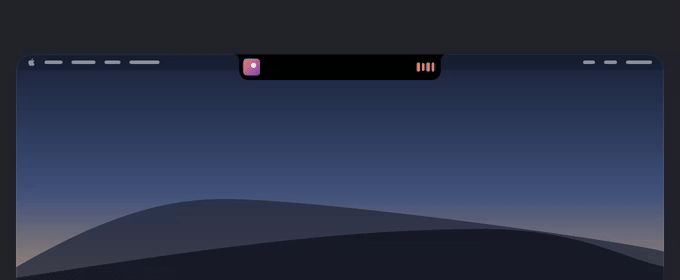
</div>

## Settings

| | |
|:-:|:-:|
| 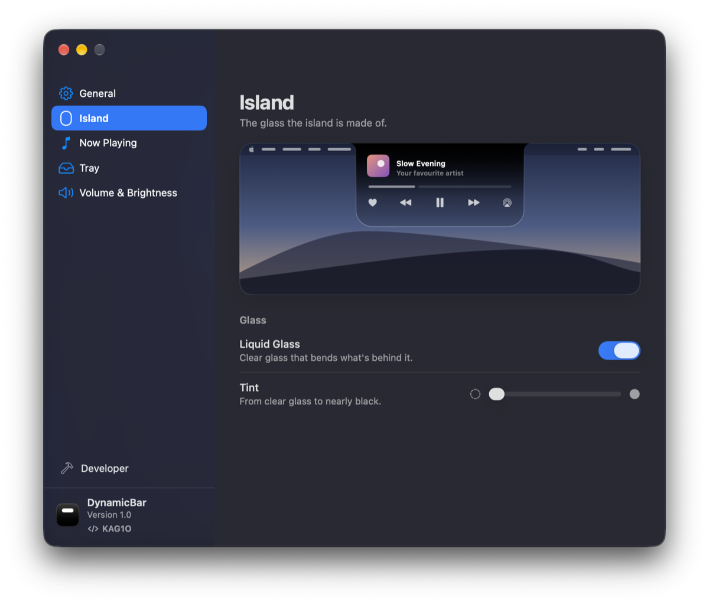 | 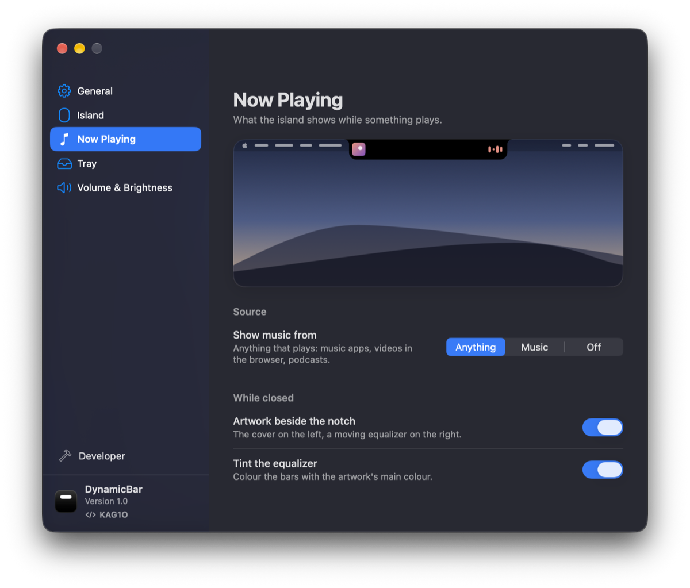 |
| 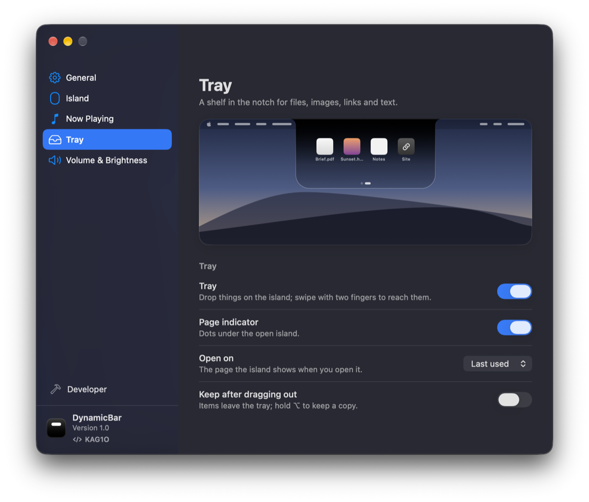 | 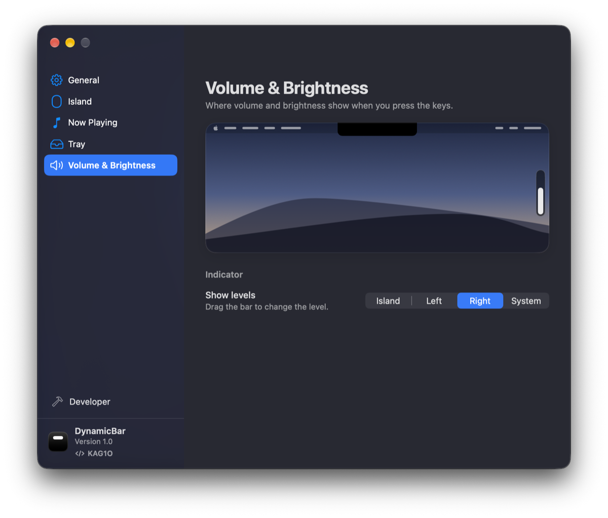 |

## Requirements

- macOS 26 or later
- Best on a MacBook with a notch; on other Macs the island hangs from the middle of the menu bar

## Install

1. Download `DynamicBar.dmg` from [Releases](https://github.com/KAG1O/DynamicBar/releases/latest) and drag **DynamicBar.app** to Applications.
2. Open it. DynamicBar isn't notarized by Apple, so the first time macOS says it can't check the app. Close the message, then go to System Settings ▸ Privacy & Security, scroll down and click **Open Anyway**.
3. The welcome window walks you through the rest. DynamicBar lives in the menu bar.

If macOS says the app is damaged, remove the download quarantine and open it again:

```bash
xattr -cr /Applications/DynamicBar.app
```

**Permissions** — *Accessibility* lets the island take over the volume and brightness keys (choose “System” in Settings and it never needs it). *Automation ▸ Music* is optional and fetches artwork from the Music app.

## Add-ons (DynamicBarKit)

Add-ons are small JavaScript programs that draw pages in the open island and show short events beside the closed one. A folder with `manifest.json` and `main.js` — no build step.

```js
const kit = DynamicBarKit;

function render() {
  kit.page({
    type: "vstack", spacing: 8, children: [
      { type: "text", text: new Date().toLocaleTimeString(), size: 40, weight: "bold", mono: true },
      { type: "button", title: "Ping", symbol: "bell.fill", action: "ping" }
    ]
  });
}

kit.onAction((action) => kit.flash({ symbol: "bell.fill", text: action }));
setInterval(render, 1000);
render();
```

1. Settings ▸ **Developer** ▸ turn on Developer Mode ▸ **Create…**
2. Edit `main.js` in `~/Library/Application Support/DynamicBar/AddOns/<your add-on>/`. Saving reloads it.
3. Share it from the add-on's menu as a `.dbaddon`.

- 📘 Full reference: [`docs/kit/DynamicBarKit.md`](docs/kit/DynamicBarKit.md) · TypeScript typings: [`docs/kit/DynamicBarKit.d.ts`](docs/kit/DynamicBarKit.d.ts)
- 🧪 Try it in the browser: [Playground](https://kag1o.github.io/DynamicBar/developer.html#playground)
- 🤖 Let an AI write one: [AI prompt builder](https://kag1o.github.io/DynamicBar/developer.html#ai) — describe the add-on, copy the prompt with the whole reference built in.

## Privacy

DynamicBar has no analytics and no account. The only request it makes on its own is an artwork lookup on Apple's iTunes Search when the playing app doesn't provide a cover. Add-ons can reach the network only with the `network` permission, which is shown before you install them.

## License

DynamicBar is free to download and use, including on a Mac you use for work. You may not sell it, include it in a paid product, use it to make money, or redistribute it outside the official releases. The code is not open source. Copyright © 2026 KAG1O; see [LICENSE.md](LICENSE.md). For other uses, [ask first](https://github.com/KAG1O).

## Feedback

Found a bug or have an idea? [Open an issue](https://github.com/KAG1O/DynamicBar/issues).

---

<div align="center">
Made by <a href="https://github.com/KAG1O">KAG1O</a>
</div>
